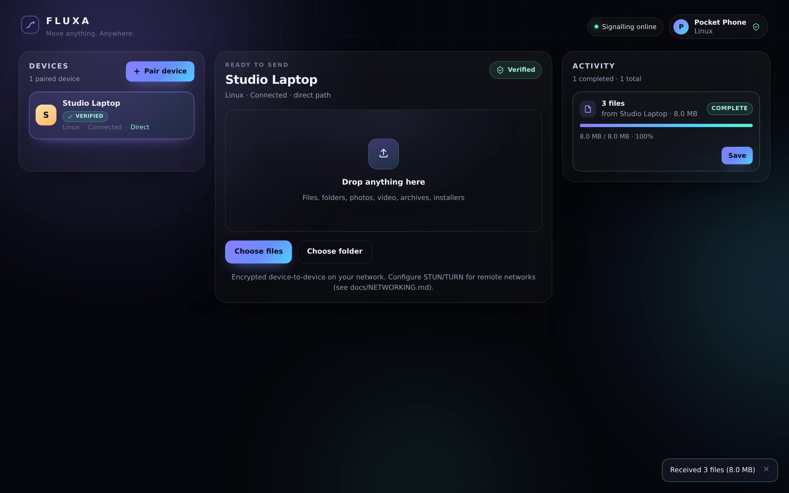

# Fluxa

**Move anything. Anywhere.** — verified, device-to-device transfer that feels like
dragging a window onto another screen.

Fluxa is a working cross-device transfer application: two independent clients pair
with a single-use code (or QR link), compare a 6-digit key-verification code, and
then stream files to each other over an encrypted WebRTC DataChannel with
per-file SHA-256 verification and honest, acknowledgement-driven progress.

This repository is a **real implementation with a verified end-to-end transfer
path** — not a mock. It is also deliberately honest about what is *not* built yet;
see [Capability matrix](#capability-matrix).



<sub>Real screenshots from the running app (two browser profiles, 8 MB / 3-file
transfer). Also: [pairing](docs/screenshots/pairing.png) ·
[key verification](docs/screenshots/verify.png) ·
[incoming transfer](docs/screenshots/incoming.png) ·
[mid-transfer progress](docs/screenshots/transferring.png)</sub>

---

## Quick start

```bash
npm install
npm run build
npm start                 # http://localhost:8787
```

Open the URL in **two different browser profiles** (or a normal window plus a
private window — device identity lives in the browser profile, so two tabs of the
same profile are the *same* device and cannot pair with themselves).

1. On device A: **Pair device** → a 6-character code and a QR link appear.
2. On device B: **Pair device** → type the code → **Join**.
3. Both devices show the same 6-digit code: compare them out of band, then press
   **Codes match** on both.
4. Drop a file (or a folder) on the drop zone and accept it on the other device.

## Verify it yourself

```bash
npm run check        # TypeScript, strict, no emit
npm test             # build + 60 unit/integration tests (node:test)
npm run test:e2e     # 12 Playwright tests, two independent browser contexts
npm audit --omit=dev # production dependency audit
```

Latest run: **60/60 unit + 12/12 browser tests passing**, `npm audit` clean. See
[docs/TEST-REPORT.md](docs/TEST-REPORT.md) for the exact commands, file sizes,
hashes and limitations.

---

## Capability matrix

Legend: ✅ implemented and verified · ⚠️ implemented with documented limits ·
🚧 designed, not implemented · ❌ not supported (and why)

| Capability | Status | Notes |
|---|---|---|
| Browser client (Chromium/Firefox/Safari engines) | ✅ | Single-page app, no framework; built with TypeScript + esbuild |
| Native Windows / macOS / Linux / Android / iOS apps | 🚧 | Not built. The protocol and transfer engine are platform-neutral TypeScript; see [docs/ARCHITECTURE.md](docs/ARCHITECTURE.md#native-clients) |
| Single / multiple file transfer | ✅ | Verified with 0 B, 41 B, 512 KB, 8 MB, 32 MB and mixed batches |
| Folder transfer (structure preserved) | ⚠️ | Directory picker uploads nested paths; the manifest and OPFS layout keep the structure, but "Save" downloads files individually (browser restriction) |
| Chunked transfer, bounded memory | ✅ | 64 KiB chunks + ack window; measured **3.3 MB** JS-heap growth for a 32 MB transfer |
| SHA-256 integrity verification | ✅ | Incremental hashing; completion requires a verified digest on both sides |
| Accurate speed / ETA / progress | ✅ | Progress is driven by receiver acknowledgements, never by bytes handed to the socket |
| Cancellation, decline, failure states | ✅ | Covered by unit and browser tests; partial data is discarded |
| **Resumable** transfers | ❌ | Not implemented. An interrupted transfer fails cleanly; see [docs/ARCHITECTURE.md](docs/ARCHITECTURE.md#resumability-not-implemented) |
| Device identity (ECDSA P-256) + pinned trust | ✅ | Non-extractable key in IndexedDB; device id = SHA-256 of the public key |
| Pairing by short-lived code / QR link | ✅ | 2-minute TTL, single use, per-device rate limits |
| 6-digit key verification (SAS) | ✅ | Derived from both identity keys + ephemeral ECDH + DTLS fingerprints |
| Rename / revoke / disconnect devices | ✅ | Trust is revoked locally; changing a trusted key is refused |
| Local-network discovery (mDNS/broadcast) | ❌ | Not implemented — pairing is code/QR only, as documented in the brief |
| Direct P2P across networks (STUN) | ⚠️ | Works when ICE host/srflx candidates succeed; needs `FLUXA_ICE_SERVERS` configured |
| Relay fallback (TURN) | ⚠️ | Supported by configuration; **no relay service is bundled or operated** |
| Honest direct-vs-relay indicator | ✅ | Reported from ICE stats (`host`/`srflx` = direct, else relayed) |
| Clipboard / links / browser handoff | 🚧 | Not implemented. No clipboard monitoring exists in this build |
| App packages (APK, MSI, DMG, DEB) | ⚠️ | Transferred as ordinary files only; Fluxa never installs or migrates an app |
| Screen sharing / task continuity | 🚧 | Interfaces are described in [docs/ARCHITECTURE.md](docs/ARCHITECTURE.md#future-continuity); none is implemented |

Anything marked 🚧 or ❌ is *not* present in the UI — Fluxa does not pretend to have
features it lacks.

---

## How a transfer actually works

```
 A (browser)                                            B (browser)
 ───────────                                            ───────────
 1. identity key (ECDSA P-256, non-extractable, IndexedDB)
 2. ── hello + signature ──►  signalling server  ◄── hello + signature ──
 3. ── createCode ─►  [6-char code, TTL 2 min, single use]
 4. ◄──────────── claimCode ────────────────────────────┘
 5. ── SDP offer / ICE ──►  relay (server only forwards)  ── answer / ICE ──
 6. ══ DTLS handshake, direct peer-to-peer, no file bytes on the server ══
 7. both sides sign a hello that binds (identity keys, session nonce, DTLS fingerprints)
    → both compute the same 6-digit code → humans compare → session unlocked
 8. manifest → accept → 64 KiB chunks → chunkAck → fileEnd(sha256) → fileResult
 9. done  (only after every file verified and finalised)
```

The server is a signalling and static-file host. It never receives file bytes.
For remote networks it can be configured with STUN/TURN; TURN relays encrypted
DTLS packets without being able to read them. See
[docs/NETWORKING.md](docs/NETWORKING.md).

### Project layout

```
src/shared/      protocol framing, crypto helpers, filename safety, validation
src/server/      HTTP static host + WebSocket signalling, pairing store, rate limits
src/client/      identity, signalling client, WebRTC peer session, transfer engine, UI
test/unit/       Node tests: protocol, crypto, pairing, signalling (real sockets), transfer engine
e2e/             Playwright: two real browsers, real WebRTC, real files
docs/            architecture, security, networking, test report, platform notes
```

## Security in one paragraph

Devices are identified by an ECDSA key pair, not by a display name. Pairing codes
are random, expire in two minutes, are single use, and are rate limited. The
transport is DTLS between the two browsers (direct, or relayed end-to-end through
TURN). Each session's 6-digit verification code is derived from both identity
keys, an ephemeral ECDH exchange and the negotiated DTLS fingerprints, so a
machine-in-the-middle — including a malicious signalling server — changes the code
the users see. Files are hashed while they stream and a file is only reported as
received after its SHA-256 matches. Read
[docs/SECURITY.md](docs/SECURITY.md) for the threat model, the assumptions, and
the things this design does **not** protect against.

## Requirements

* Node.js ≥ 20 (server and tests)
* A modern browser with WebRTC DataChannels and IndexedDB
* Linux/macOS/Windows for the server; it is a single process with no database

## License

MIT — see [LICENSE](LICENSE).
